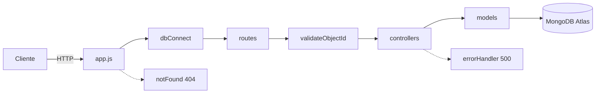
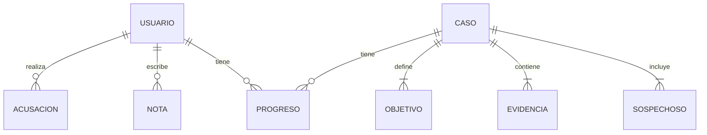

# Expediente Abierto API

API REST del juego de detectives Expediente Abierto. Hecha con Node.js, Express y MongoDB Atlas (Mongoose), desplegada en Vercel.

Repositorio: https://github.com/Alexadefig/expedienteAbierto

## Estructura

```
backend/
├── src/
│   ├── config/db.js
│   ├── models/          Usuario, Caso, Sospechoso, Objetivo
│   ├── controllers/     caso.controller.js, usuario.controller.js
│   ├── routes/          index.js, caso.routes.js, usuario.routes.js
│   ├── middlewares/     notFound, errorHandler, validateObjectId, dbConnect
│   ├── utils/AppError.js
│   └── app.js
├── server.js
├── .env.example
├── requests.http
└── expediente-abierto.postman.json
```

## Modelos

**Caso** (entidad principal): `codigo` (único, formato EXP-0000), `titulo`, `descripcion`, `victima`, `ubicacion`, `fechaDelCrimen`, `dificultad` (baja, media, alta), `estado` (disponible, borrador, archivado), `imagenPortada`, `solucion`. La solución nunca se devuelve en las respuestas.

**Usuario**: `nombre`, `email` (único), `passwordHash`, `fechaRegistro`, `activo`, `rol` (jugador, admin), `preferencias`. La contraseña se guarda cifrada con bcrypt y el hash nunca se devuelve.

**Sospechoso**: `casoId`, `nombre`, `edad`, `ocupacion`, `biografia`, `declaracion`, `coartada`, `relaciones`, `imagen`.

**Objetivo**: `casoId`, `titulo`, `descripcion`, `orden`, `tipo`, `obligatorio`.

## Endpoints

| Método | Ruta | Descripción |
|---|---|---|
| GET | `/api/health` | Estado de la API |
| GET | `/api/casos` | Listar casos (filtros `?dificultad=` y `?estado=`) |
| GET | `/api/casos/:id` | Obtener un caso |
| POST | `/api/casos` | Crear un caso |
| PUT | `/api/casos/:id` | Actualizar un caso |
| DELETE | `/api/casos/:id` | Eliminar un caso y sus datos asociados |
| GET | `/api/casos/:id/sospechosos` | Sospechosos de un caso |
| GET | `/api/casos/:id/objetivos` | Objetivos de un caso |
| GET | `/api/usuarios` | Listar usuarios |
| GET | `/api/usuarios/:id` | Obtener un usuario |
| POST | `/api/usuarios` | Crear un usuario (`nombre`, `email`, `password`) |
| PUT | `/api/usuarios/:id` | Actualizar un usuario |
| DELETE | `/api/usuarios/:id` | Eliminar un usuario |

Respuesta correcta:

```json
{ "ok": true, "total": 3, "data": [] }
```

Respuesta de error:

```json
{ "ok": false, "mensaje": "Datos no válidos", "detalles": ["El título es obligatorio"] }
```

Códigos de error: 400 (datos o id no válidos), 404 (ruta o recurso no encontrado), 409 (código o email duplicado), 500 (error del servidor).

## Instalación

```bash
git clone https://github.com/Alexadefig/expedienteAbierto.git
cd expedienteAbierto/backend
npm install
cp .env.example .env
npm run dev
```

## Variables de entorno

| Variable | Descripción |
|---|---|
| `MONGODB_URI` | Cadena de conexión de MongoDB Atlas |
| `DB_NAME` | Nombre de la base de datos (`expediente_abierto`) |
| `PORT` | Puerto local (3000 por defecto) |

## Pruebas

- `requests.http`: se ejecuta con la extensión REST Client de VS Code.
- `expediente-abierto.postman.json`: se importa en Postman o Thunder Client.

Ambos incluyen todos los endpoints y los casos de error. Para probar el despliegue, cambia `baseUrl` por la URL de Vercel.

## Despliegue en Vercel

1. Subir el proyecto a GitHub.
2. Importar el repositorio en Vercel con Root Directory `backend`.
3. Añadir `MONGODB_URI` y `DB_NAME` en Environment Variables.
4. En Atlas, permitir el acceso desde `0.0.0.0/0` en Network Access.
5. Comprobar que `/api/health` responde en la URL de Vercel.

## Diagramas

### Flujo de una petición



### Modelo de datos


